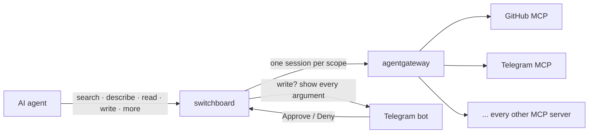

<!-- readme:header:start -->
<picture><source media="(prefers-color-scheme: dark)" srcset="https://raw.githubusercontent.com/Egoushka/Egoushka/main/assets/card-switchboard-dark.svg"></picture>

<p>
  
  <a href="https://github.com/Egoushka/switchboard/actions/workflows/ci.yml"></a>
  
</p>
<!-- readme:header:end -->

# switchboard

> One MCP front door to every tool behind your gateway: agents see five tools instead of hundreds, and every write waits for a tap on your phone.

<!-- readme:status:start -->
**Parked**. It works; I am not changing it now and may come back.
<!-- readme:status:end -->



## Why

An agent connected to every MCP server I run reads hundreds of tool definitions before it reads the task, and any
one of those tools can change something. I wanted the agent to look tools up instead of carrying them all, and I
wanted a person, not the tool's own description of itself, to decide what may write.

## What it does

- **Five tools instead of hundreds.** `search` finds a tool, `describe` returns its arguments, `read` runs it,
  `write` runs it after approval, `more` pages a long result.
- **Config decides what reads.** A tool is `read` only if the config says so. A server with no entry is all
  `write`, and a `destructiveHint` always forces `write`.
- **Approvals you can trust.** Each write shows every argument on Telegram, with zero-width and bidi characters
  printed as visible escapes. Approvals are single-use, bound to exactly the arguments shown, denied on timeout
  and refused when Telegram is unreachable.
- **Small results.** Nulls dropped, an optional JMESPath `query` applied, the first page capped at 6,000 characters.
- **An audit line per write**, before and after the call, with a hash of the arguments, never the arguments.

Not here: client keys and allow-lists (the gateway owns them), stdio transport, more than one approver, anything
on disk. [What it does not do](docs/guide/index.md#what-it-does-not-do) has the full list.

> [!WARNING]
> `pip install switchboard` installs an unrelated PyPI project. Use the container image or a clone.

## Quick start

Runs the smoke test CI runs: switchboard between a real agentgateway and a fake MCP server, with a fake Telegram
approver. Needs Docker with Compose and [uv](https://docs.astral.sh/uv/).

```bash
git clone https://github.com/Egoushka/switchboard.git && cd switchboard
uv sync && uv run pytest
docker build -t switchboard:dev .
docker compose -f tests/smoke/compose.yaml up -d
uv run python tests/smoke/check.py
```

The [quickstart guide](docs/guide/quickstart.md) explains each step and what the output means.

## How it works

Each *scope* in the config is an MCP endpoint at `/mcp/<scope>` holding one long-lived session to a gateway route.
`search` ranks that route's tools with BM25 over server name, description and tool name. `write` sends the tool,
its arguments and the agent's reason to Telegram and runs the call once if Approve arrives before the timeout
(50 s by default). An approved call runs to the end even if the client gives up.
[How it works](docs/guide/how-it-works.md) follows one request through every part.

## Numbers

| | Value | Source |
|---|---|---|
| Tools an agent sees | 5 (4 in a read-only scope) | `test_integration.py` checks both lists |
| Tests | 91, all offline, plus a smoke test against a real agentgateway | [status](docs/guide/status.md) |
| Users | 1, me | counted |

## Docs

- [Overview](docs/guide/index.md): who it is for, the tools, limits, status
- [Quickstart](docs/guide/quickstart.md): the smoke stack, step by step
- [Deploy](docs/guide/deploy.md): config, environment, container, routing clients, measuring the savings
- [Approvals](docs/guide/approvals.md): what the approver sees, what the agent gets back, the audit log
- [How it works](docs/guide/how-it-works.md) · [Reference](docs/guide/reference.md) · [Status and evidence](docs/guide/status.md)
- [Changelog](CHANGELOG.md)

<!-- readme:footer:start -->
---

<sub>Made by [Yehor Hrabovskyi](https://hrabovskyi.online) · [MIT licence](LICENSE).</sub>
<!-- readme:footer:end -->
